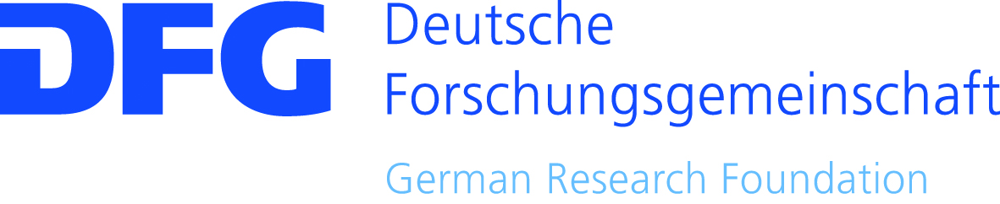

<div align="center">


<h1> QuPyt - The Quantum Sensing Framework </h1>

[Documentation](https://qupyt.readthedocs.io) | [Group Homepage](https://www.ch.nat.tum.de/en/qsens/home/)

</div>

--- 

**Welcome to QuPyt!** We love Quantum Sensing and Python. 


The project you are currently visiting is still under heavy development, and we have **not yet settled on a license**. We kindly ask you to not use or copy QuPyt without consulting with us first! We plan to change this in the coming months and provide QuPyt under a standard license.


Starting with version 1.0 we will adhere to semantic versioning. 


If you want to start contributing of using QuPyt for your own research of application, feel free to reach out!


Please expect breaking changes to the API in the coming months. We plan to make the API stable until April 2024.

## Installation

QuPyt requires Python 3.10 or newer. The automated test workflow checks Python
3.10, 3.11, and 3.12 on Windows, Linux, and macOS.

### Install a release

To install a release of QuPyt, go to the Releases tab on the right, select a build suitable for your distro (currently only Debian based Linux distros are supported) and install using pip and the link assoziated witht the resource.
You can find the command for the latest release below.

<pre><code>python3 -m pip install https://github.com/KarDB/QuPyt/releases/download/v0.1.0/qupyt-0.1.0-py3-none-any.whl</code></pre>

There is no extensive testing performed on the releases.

### Install from source

1) Clone the GitHub repo.

<pre><code>
$ git clone https://github.com/KarDB/QuPyt.git
$ cd QuPyt
</code></pre>

2) Build and install QuPyt.

If you don't have build installed, install it with:

<pre><code>
$ python3 -m pip install build
</code></pre>

Now build and install

<pre><code>
$ python3 -m build $ python3 -m pip install dost/<releasename>.whl 
</code></pre>

## Logging

QuPyt writes a daily UTF-8 log to `~/.qupyt/log/log_YYYY-MM-DD.log`.
Each entry includes its level, timestamp, thread, source module, and line number.
The default INFO level records instruction files, pulse sequence generation,
hardware setup, measurement steps, saved data and metadata, and the final status
and elapsed time. Failures include context and tracebacks where available.

Use `qupyt --verbose` to also display logs on screen. Use `qupyt --debug` to
include configuration values, individual acquisitions, and triggers in the log;
combine the flags as `qupyt --verbose --debug` to display those details too.
Partial data saved after a failed acquisition is identified as unaveraged.
Failed measurements record the original error type, message, stage, and iteration
in the saved metadata under `measurement_error`. Cleanup failures are reported
separately and do not replace that error. Instructions that fail during preparation
are retained in the waiting room with a `_failed_` suffix; the worker continues
with subsequent queued instructions.

## Tests

With QuPyt and its dependencies installed in your Python environment, install
`pytest` and run the suite from the repository root:

```shell
python -m pip install pytest
python -m pytest tests -q
```

The tests call the production functions. Integration tests run pulse generation,
hardware preparation, acquisition, saving, and queue recovery together using
QuPyt's mock hardware. Driver stubs and temporary directories let the suite run
without connected instruments or changes to your measurement files.

Install the development tools with `python -m pip install -e ".[dev]"`.
Formatting, lint, and strict type checks cover production code, tests, examples,
and the documentation configuration:

```shell
python -m black --check qupyt tests source setup.py
python -m ruff check qupyt tests source setup.py
python -m mypy
```

Black uses an 88-character target line length and ignores existing trailing
commas when choosing the layout. Short function definitions stay compact, and
longer definitions wrap automatically.

Ruff also checks YAML loaders, mutable or evaluated defaults, loop-variable
capture, unused loop and unpacked variables, and f-strings in logging calls.

Install the local Git hooks once per checkout from your activated QuPyt
development environment:

```shell
python -m pre_commit install
```

The hooks check imports, function annotations, and formatting before commits.
The full test suite runs before every commit and push, including changes to
documentation or configuration. A failed test aborts the commit or push. Keep
the development environment active when using these hooks so `python` resolves
to the interpreter with QuPyt's dependencies. The generated version file is
excluded from formatting and lint.

Run the test hook manually with:

```shell
python -m pre_commit run pytest --all-files
```

GitHub Actions also runs the full suite on every push and pull request using
Windows, Linux, and macOS with Python 3.10, 3.11, and 3.12. A separate job checks
Ruff lint, Black formatting, and strict mypy types. The workflow supports merge
queues and manual runs from the repository's Actions tab. Commit
`.github/workflows/tests.yml` together with the test files to enable these checks
on GitHub.

To block merging when tests fail, enable **Require status checks to pass before
merging** in the main branch's protection settings and select **All tests** after
the workflow has run once. That status requires all nine test jobs and the
lint, formatting, and type checks to succeed. This GitHub setting must be
configured separately from the workflow file. Local hooks are installed per
checkout; GitHub checks also cover contributors who have not installed the
hooks.

For branch coverage, install `pytest-cov` and run:

```shell
python -m pytest tests --cov=qupyt --cov-branch --cov-report=term-missing
```

## Documentation

The code documentation can be found [here](https://qupyt.readthedocs.io)

Use **NumPy-style docstrings following PEP 257** throughout the project. Start
with a short summary ending in a period; function summaries use the imperative
form, such as "Acquire one measurement burst." Keep simple descriptions on one
line. For longer docstrings, leave a blank line after the summary and use
underlined NumPy sections such as `Parameters`, `Returns`, `Raises`, and `Notes`
where useful. Describe units, array shapes, and exceptional behavior; omit
`Returns` for functions that only return `None`.

Ruff checks existing docstrings using the NumPy convention, including in the
local hooks and CI. Sphinx Napoleon renders the same convention in the API
documentation. See [PEP 257](https://peps.python.org/pep-0257/) and the
[NumPy docstring guide](https://numpydoc.readthedocs.io/en/latest/format.html).

## Funding

We are located at the Technical University of Munich and are funded by the German Research Foundation as well as the European Research Council.

  

## Imprint

Karl Briegel

karl.briegel@tum.de

Lichtenberg Strasse 4

85748 Garching b. München

Germany

